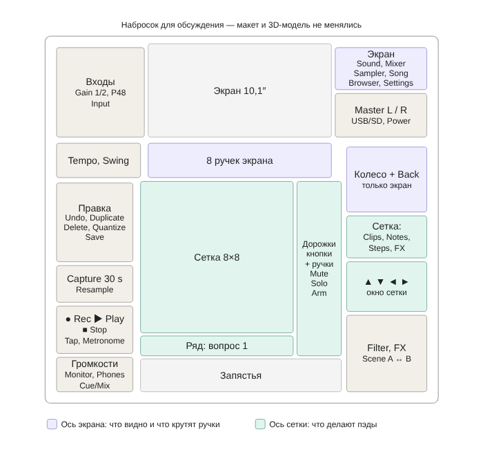
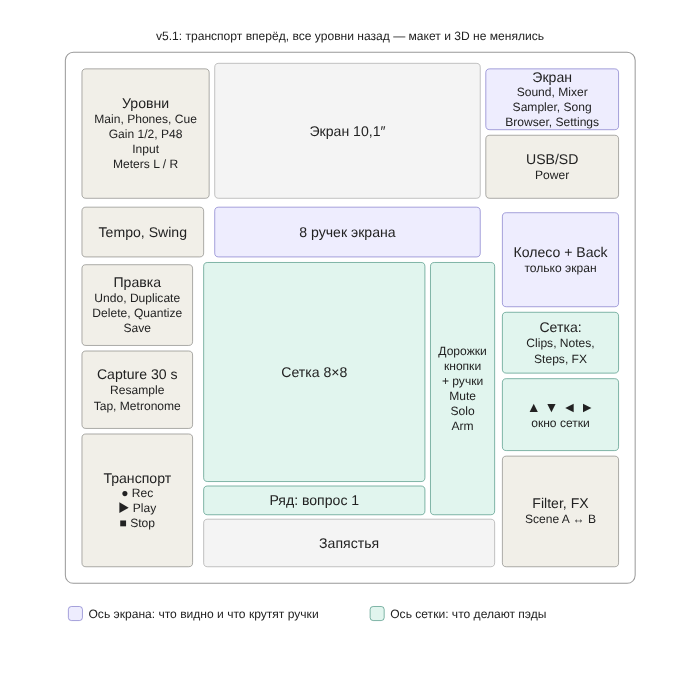
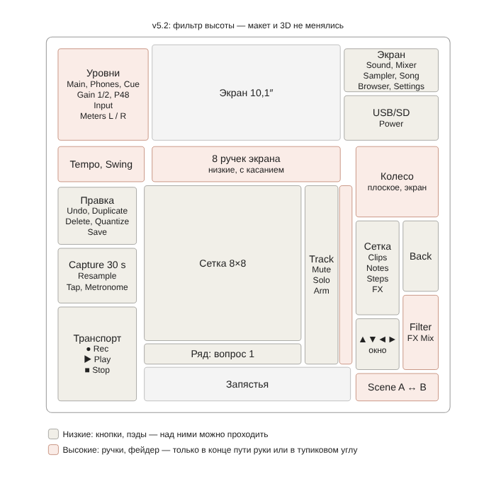

# Штука Дрюка: что я сделал в макете v4, почему, и что поменять (наброски v5)

*31.10.2026. Ответ на претензии пользователя к макету v4 (дополнен разделами 6–8). Макет и 3D-модель пока не меняются — это предложения для обсуждения. Продолжает документ 22.*

## 0. Принципы пользователя (решено, R89)

- Push MK1 освоил почти сразу, без путаницы, по обзорам. Многослойность пугает; многослойность SP-404 — «вообще кошмар».
- **«Лучше на 20 кнопок больше, чем общая тетрадь с заметками, какие кнопки и в каком количестве жать».**
- Названия могут быть любыми — к словам привыкаешь. Важно, как всё собрано.
- Опыт с его устройствами — ориентир привычки, а не образец: «не обязательно строить всю систему только по Push 1 и Circuit».

## 1. Устройства пользователя и чему они учат

| Устройство | Что в нём понятно | Что берём как принцип (вывод) |
|---|---|---|
| Ableton Push 1 | Слева колонка действий: Tap Tempo, Metronome, Undo, Delete, Double, Quantize, Fixed Length, Automation, Duplicate, New, **Record и Play внизу**. Справа — запуск сцен у сетки, режимы, Mute/Solo, Note/Session, Shift и **стрелки, которые двигают видимую часть сетки**: влево-вправо — дорожки, вверх-вниз — сцены, с Shift — на 8. Над экраном 8 ручек, под экраном 2 ряда кнопок выбора, справа от экрана 6 кнопок «что крутят ручки»: Volume, Track, Device, Pan & Send, Clip, Browse ([Ableton](https://www.ableton.com/en/live-manual/12/using-push-1/), [zcx](https://zcx-core.pages.dev/latest/reference/hardware/push-1/)) | Две оси: Session/Note — что делают пэды; 6 кнопок справа от экрана — что делают ручки. Стрелки — только для сетки |
| Arturia AudioFuse | Все уровни на верхней панели в одном месте: усиление входов, Main, Cue, наушники и их громкость, Mono, Mute, переключение колонок, Talkback. Обозреватель: раскладка логичная, «как только разобрался — интуитивно и быстрее, чем в софте» ([Ask.Audio](https://ask.audio/articles/review-arturia-audiofuse)) | Блок «Уровни» как на звуковой карте |
| Steinberg CI2 | Одна ручка AI Knob крутит то, на что наведён курсор ([zZounds](https://www.zzounds.com/item--STECI2)) | Главное колесо — «ручка того, что выделено на экране» |
| Akai MPD218 | Пэды и ручки без экрана | — |
| Behringer TD-3 | Одна ручка — одна функция | Отдельные подписанные ручки для самого частого |

## 2. Разбор v4: что, почему, что предлагаю

| Блок v4 | Почему я так сделал | Беда | Предложение для v5 |
|---|---|---|---|
| Транспорт Rec, Play, Stop, Tap (слева внизу) | Место как у Push 1 и Maschine — у пэдов слева внизу | Кнопки как все: размер, цвет, нет ▶ ■ ● — глаз не находит | **Оставить место**, сделать крупнее, со значками и цветом (Play зелёный, Rec красный), Tap и Metronome рядом |
| Страницы Grab, Shape, Perform, Arrange | Моя идея «одна кнопка меняет сразу экран, ручки, сетку и свет» (документ 08) | Глаголы ничего не говорят; не видно, что делает сетка | **Убрать.** Вместо них две оси, как у Push: режимы сетки и режимы экрана (раздел 5) |
| Capture, Freeze | Skip Back у SP-404 (запись последних секунд), ресэмплинг у Octatrack | Непонятные слова, стоят отдельно от Rec | **Перенести к транспорту** — это тоже запись. Подписи: «Capture (last 30 s)», «Resample» |
| Правка Undo, Copy, Delete, Save | Push 1, MPC | Нормально | Оставить; добавить Quantize (как у Push 1) |
| Входы у экрана: Gain 1/2, P48, Input | Настраивают редко → далеко от рук (документ 17) | Громкости спереди, гейны сзади — уровни в двух местах | Решить вопрос блока «Уровни» (раздел 4) |
| Один индикатор Main | Ошибка | Стерео, а столбик один | **Два столбика L/R** мастера у экрана; остальные уровни — на экране |
| Колесо + Back и 4 стрелки рядом | R15: окно сетки двигается «либо стрелками, либо энкодером главным» — я поставил оба способа рядом; пользователи Push 3 просили, чтобы стрелки дублировали колесо (документ 09) | Две вещи делают одно и то же и стоят вместе — непонятно, зачем | **Развести** (раздел 3) |
| 8 кнопок и 8 ручек справа от сетки | Твоё раннее пожелание: «справа от сетки по одной-две ручки на каждую сцену (громкость, панорама или другие)»; R15: строки = дорожки | Ручки не подписаны; Mute/Solo меняют смысл кнопок незаметно | Оставить, если строки = дорожки (вопрос 1); подписать «Track»; добавить Rec Arm рядом с Mute/Solo |
| Ряд 8 кнопок под сеткой | Если строки — дорожки, то столбцы — время/сцены, и запуск сцены — под своим столбцом | У Push сцены справа — для тебя непривычно | Зависит от вопроса 1 |
| 6 Macro | Q-Link у MPC, макро у Push | Шесть неподписанных ручек | **Заменить** одной-двумя постоянными ручками с одной функцией: «Filter» всегда фильтр мастера (как у Circuit, документ 22), «FX» — глубина эффектов |
| Кроссфейдер + A/B | Сцены и кроссфейдер у Octatrack | Для не-диджея неясно, что смешивается | Оставить, подписать «Scene A ↔ Scene B» |
| Browser, Menu, Power, USB/SD | Maschine, MPC | Нормально | Оставить; Browser перенести к кнопкам экрана |
| Громкости Monitor, Phones, Cue/Mix спереди слева | AudioFuse, Force | Нормально | Оставить |

## 3. Колесо и стрелки: почему так и как развести

**Почему так вышло.** В R15 ты решил, что окно сетки двигается «либо стрелками, либо главным энкодером». Я поставил оба способа рядом, а в документе 09 ещё добавил, что пользователи Push 3 просят стрелки как полную замену колеса. В итоге две вещи делают одно и то же, стоят вместе и не похожи ни на одну ось — ты это правильно заметил.

**Предложение P54 (вывод):** одна вещь — одна работа, и стоит у того, чем управляет.
- **Стрелки ▲▼◄► — только сетка.** Стоят у сетки (как у Push 1): сдвиг окна на строку или столбец, удержание — на 8.
- **Колесо — только экран.** Стоит у экрана рядом с Back и кнопками экрана: листать списки, менять выделенное значение, нажатие — «OK». Это как AI Knob у твоего CI2: крутит то, что выделено на экране.

## 4. Блок «Уровни»: за и против

| За | Против |
|---|---|
| Всё про громкость в одном месте: «нет звука — смотрю сюда» | Гейны нужны редко, громкости — часто: один блок на лучшем месте у рук занимает место редкими ручками |
| Читается по пути звука: вход → индикаторы → выход | Кнопки P48 рядом с часто трогаемыми громкостями — риск случайно включить фантом (норма FAA: размещение против ошибок, документ 17) |
| Так сделано у твоего AudioFuse, и обозреватель называет это логичным и быстрым | Блок становится большим: 3 потенциометра + 2 энкодера усиления + 2 P48 + выбор входа + 2 индикатора |
| Индикаторы перегруза входов — рядом с ручкой, которой его исправляешь | Гнёзда наушников спереди слева — громкости должны остаться у них |

~~Компромисс: входы сзади, громкости спереди у гнёзд наушников.~~ Заменён разделом 6: по частоте использования громкостям у рук не место, весь блок «Уровни» уходит назад, а вперёд — транспорт. P48 — утопленные кнопки или с удержанием, чтобы не нажать случайно.

## 5. Набросок v5 (предложения P53–P55 в журнале)

- **Режимы сетки** (что делают пэды), у сетки: **Clips · Notes · Steps · FX**.
- **Режимы экрана** (что показывает экран и крутят 8 ручек под ним), у экрана: **Sound · Mixer · Sampler · Song · Browser**.
- **Транспорт** крупный, слева внизу: ● Rec, ▶ Play, ■ Stop + Tap, Metronome, Capture, Resample.
- **Правка** слева над транспортом: Undo, Duplicate, Delete, Quantize, Save.
- **Стрелки** у сетки справа внизу; **колесо + Back** у экрана справа.
- **Индикаторы L/R** мастера у экрана.
- **Filter** и **FX** — постоянные ручки; кроссфейдер «Scene A ↔ B».
- Убираются: Grab/Shape/Perform/Arrange, 6 Macro.

## 6. Частота использования (R90, P56)

Пользователь: «Досягаемость — это хорошо, но должна присутствовать логика частоты использования. Как часто ты крутишь ручки громкости, а как часто старт/стоп?»

**Факт:** нормы раскладки органов управления (EN 894-4, MIL-STD-1472) ставят рядом с оператором органы по частоте и важности использования, группируют по функции и порядку действий; органы аварийного действия должны легко находиться, но быть защищены от случайного срабатывания (документы 06, 17).

**Где я ошибся в v4:** громкости стояли у переднего края потому, что там гнёзда наушников, — это группировка по разъёму, а не по частоте. Заодно передний край — место, где ручку задевает запястье.

| Что | Как часто (оценка, вывод) | Нужно ли попасть в долю | Куда |
|---|---|---|---|
| Пэды, сетка | Непрерывно | Да | Центр, под руками |
| Ручки экрана и дорожек | Постоянно, пока крутишь звук | Нет | У сетки и под экраном |
| ● Rec, ▶ Play, ■ Stop | Десятки раз за сессию | **Да** — запись и старт жмут в долю | **Передний левый угол**, крупно |
| Undo | Часто | Нет | Над транспортом |
| Режимы сетки и экрана, стрелки | Часто | Нет | У того, чем управляют |
| Tap, Metronome, Capture, Resample | Иногда | Tap — да | Рядом с транспортом |
| Main | В начале и изредка; аварийно, если слишком громко | Нет | Сзади слева, крупная заметная ручка в углу — находится вслепую |
| Phones, Cue | Редко | Нет | Там же |
| Gain, P48, Input | Один раз на подключение | Нет | Там же; P48 защищён |

**Пример с устройства пользователя:** у Push 1 Play и Record — внизу левой колонки, у рук, а громкость Master — энкодер наверху справа, в ряду над экраном.

**Вывод (P56):** транспорт — в передний левый угол; весь блок «Уровни» (Main, Phones, Cue, Gain 1/2, P48, Input, индикаторы L/R) — сзади слева у экрана, как на AudioFuse, но в дальней зоне. Гнёзда наушников могут остаться на переднем торце: ручке не обязательно стоять рядом с гнездом.

## 7. Фильтр высоты (R91, P57)

Пользователь: «Если ты часто пользуешься кнопками и по пути у тебя кнопка громкости, с какой вероятностью крутилка громкости превратится в крутилку громкости стратокастера на фендере?»

**Факт:** нормы (MIL-STD-1472, FAA HFDS) требуют защищать органы от случайного срабатывания: расположением и ориентацией (вне пути руки), утоплением, ограждением, усилием, блокировкой.

**Вывод — правило:** риск = вероятность задеть × последствия.
- Низкие органы (кнопки, пэды, несколько миллиметров) — спереди и ближе к центру: над ними рука проходит безопасно.
- Высокие (ручки, фейдер) — сзади, у внешних краёв, в конце пути руки или в тупиковых углах, куда рука идёт только за ними.
- Чем хуже последствия, тем дальше от пути: громкость, Gain, P48, темп — в тупиковом углу; колесо списков задеть не страшно — оно только листает.

**Где v4 и v5.1 нарушали правило:**

| Место | Беда | Исправление в v5.2 |
|---|---|---|
| Справа спереди: Macro (v4), Filter/FX (v5.1) и кроссфейдер перед стрелками, режимами и колесом | Рука к стрелкам и колесу идёт над ручками — «стратокастер» | Внутренняя дорожка правой колонки — только кнопки (стрелки, режимы сетки); Filter и FX Mix — на внешнем краю; кроссфейдер — у передней кромки, его ход поперёк движения руки |
| Ручки дорожек между сеткой и правой колонкой | Рука вбок к правой колонке проходит над ними | Кнопки дорожек — к сетке, ручки — снаружи; ручки низкие, с датчиком касания (SDP ENC_TOUCH) |
| 8 ручек экрана между сеткой и сенсорным экраном | Рука к экрану проходит над ними | Низкие колпачки; пока касаются экрана, повороты ручек экрана игнорируются (блокировка в софте) |
| Громкости у передней кромки (v4) | Запястье задевает | Уже убрано в v5.1 (P56): уровни в тупиковом углу сзади слева, Gain утоплены, P48 защищены |
| Tempo, Swing перед блоком «Уровни» | Рука к уровням проходит над темпом | Допустимо: к уровням тянутся редко; темп — энкодер, задетый на щелчок даёт ±1 BPM |

## 8. Push 1 — не эталон: что поменяли в Push 2 и Push 3 (R92)

| Поколение | Что изменили (факт) | Источник | Что это значит для нас (вывод) |
|---|---|---|---|
| Push 2 | Кнопки почти вровень с панелью, пэды выступают меньше, у энкодеров убрали юбки; экран больше и цветной, но не сенсорный; ряды кнопок выбора над и под экраном; Mute, Solo, Stop Clip перенесли налево; Track, Volume, Pan & Send слили в одну кнопку Mix; транспорт остался слева | [Sound On Sound](https://www.soundonsound.com/reviews/ableton-push-2) | Низкий профиль — тот же фильтр высоты. Транспорт слева держится во всех поколениях — подтверждает P56 |
| Push 3 | Добавили колесо справа: листает сетку, вправо-влево — дорожки, нажатие — запуск сцены, ещё браузер. Кнопки снова твёрже и чуть выступают, с рёбрами — обозреватель считает это лучше резиновых вровень. Перегруппировали: запись слева, правка — кластером справа | [Sound On Sound](https://www.soundonsound.com/reviews/ableton-push-3) | Кнопки — чуть выше панели, с чётким щелчком; ручки — низкие |
| Push 3: колесо | Жалобы: в браузере влево-вправо колесо ничего не делает, приходится снимать пальцы и жать стрелки; модератор: колесо должно всегда заменяться стрелками | [форум Ableton](https://forum.ableton.com/viewtopic.php?p=1812509) | Колесо с двумя работами (сетка и списки) путает — подтверждает P54: колесо — только экран, стрелки — только сетка |
| Push 3: громкость | Одна ручка громкости слева от экрана; нажатием перебирает Main Output → Headphone Output → Master → Cue. Тема пользователей «не могу поменять громкость наушников» | [форум Ableton](https://forum.ableton.com/viewtopic.php?p=1811403), [руководство Push](https://www.ableton.com/en/push/manual/) | Ровно та многослойность, которую ты не хочешь (R89): у нас отдельные ручки Main, Phones, Cue (R87, P56) |

**Открытый вопрос (вывод):** Push 3 перенёс правку направо. Для нас это вопрос аккордов «держи Delete — жми пэд»: если правка у левой руки, правая свободна для пэда и наоборот. Решать вместе с ориентацией сетки.

## Открытые вопросы

1. **Ориентация сетки.** Сейчас (R15) строки — дорожки, время идёт слева направо, ручки дорожек справа от сетки (твоё раннее пожелание). У Push и Ableton наоборот: дорожки — столбцы, сцены — строки, запуск сцен справа. Переворачиваем под привычку Push или оставляем строки?
2. ~~Блок «Уровни»~~ — см. раздел 6 (R90, P56).
3. Набросок v5 в целом — в эту сторону?
