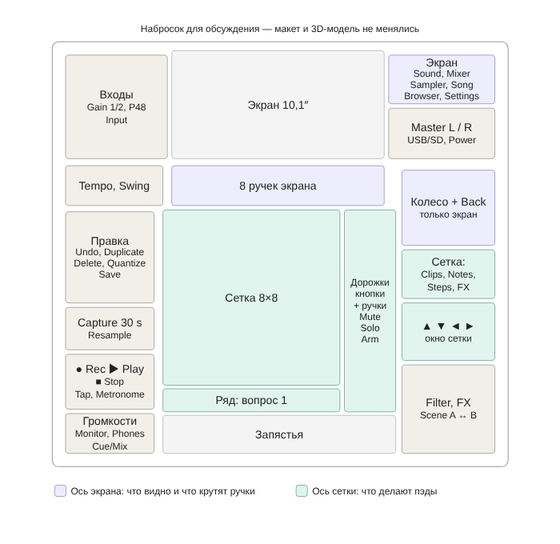

> Часть документа 23 ([индекс](../23_v4_explained_v5_proposals.md)): 5. Набросок v5 (предложения P53–P55 в журнале)

## 5. Набросок v5 (предложения P53–P55 в журнале)

- **Режимы сетки** (что делают пэды), у сетки: **Clips · Notes · Steps · FX**.
- **Режимы экрана** (что показывает экран и крутят 8 ручек под ним), у экрана: **Sound · Mixer · Sampler · Song · Browser**.
- **Транспорт** крупный, слева внизу: ● Rec, ▶ Play, ■ Stop + Tap, Metronome, Capture, Resample.
- **Правка** слева над транспортом: Undo, Duplicate, Delete, Quantize, Save.
- **Стрелки** у сетки справа внизу; **колесо + Back** у экрана справа.
- **Индикаторы L/R** мастера у экрана.
- **Filter** и **FX** — постоянные ручки; кроссфейдер «Scene A ↔ B».
- Убираются: Grab/Shape/Perform/Arrange, 6 Macro.

