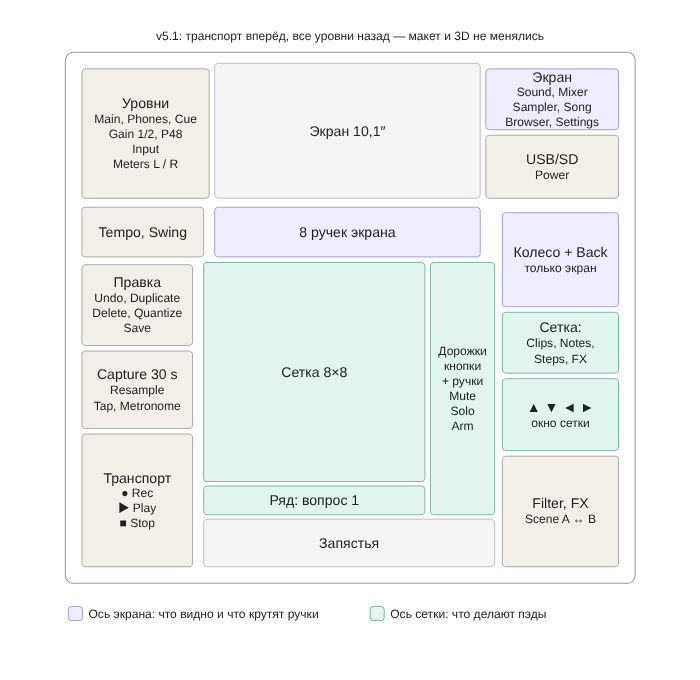

> Часть документа 23 ([индекс](../23_v4_explained_v5_proposals.md)): 6. Частота использования (R90, P56)

## 6. Частота использования (R90, P56)

Пользователь: «Досягаемость — это хорошо, но должна присутствовать логика частоты использования. Как часто ты крутишь ручки громкости, а как часто старт/стоп?»

**Факт:** нормы раскладки органов управления (EN 894-4, MIL-STD-1472) ставят рядом с оператором органы по частоте и важности использования, группируют по функции и порядку действий; органы аварийного действия должны легко находиться, но быть защищены от случайного срабатывания (документы 06, 17).

**Где я ошибся в v4:** громкости стояли у переднего края потому, что там гнёзда наушников, — это группировка по разъёму, а не по частоте. Заодно передний край — место, где ручку задевает запястье.

| Что | Как часто (оценка, вывод) | Нужно ли попасть в долю | Куда |
|---|---|---|---|
| Пэды, сетка | Непрерывно | Да | Центр, под руками |
| Ручки экрана и дорожек | Постоянно, пока крутишь звук | Нет | У сетки и под экраном |
| ● Rec, ▶ Play, ■ Stop | Десятки раз за сессию | **Да** — запись и старт жмут в долю | **Передний левый угол**, крупно |
| Undo | Часто | Нет | Над транспортом |
| Режимы сетки и экрана, стрелки | Часто | Нет | У того, чем управляют |
| Tap, Metronome, Capture, Resample | Иногда | Tap — да | Рядом с транспортом |
| Main | В начале и изредка; аварийно, если слишком громко | Нет | Сзади слева, крупная заметная ручка в углу — находится вслепую |
| Phones, Cue | Редко | Нет | Там же |
| Gain, P48, Input | Один раз на подключение | Нет | Там же; P48 защищён |

**Пример с устройства пользователя:** у Push 1 Play и Record — внизу левой колонки, у рук, а громкость Master — энкодер наверху справа, в ряду над экраном.

**Вывод (P56):** транспорт — в передний левый угол; весь блок «Уровни» (Main, Phones, Cue, Gain 1/2, P48, Input, индикаторы L/R) — сзади слева у экрана, как на AudioFuse, но в дальней зоне. Гнёзда наушников могут остаться на переднем торце: ручке не обязательно стоять рядом с гнездом.

