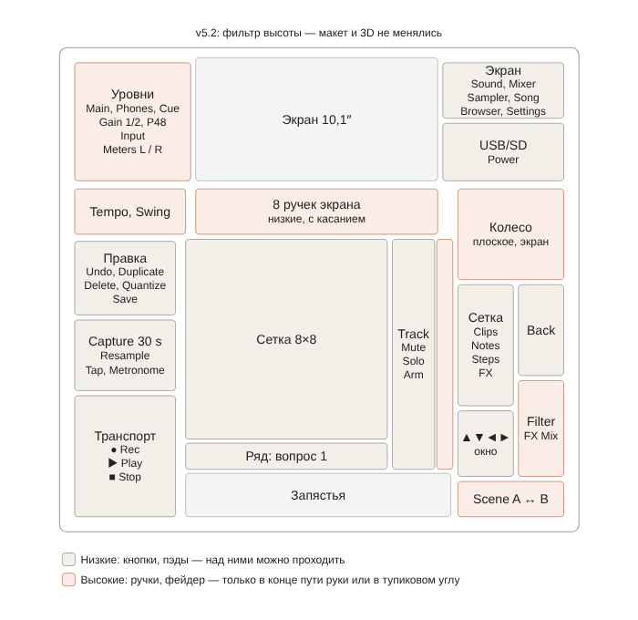

> Часть документа 23 ([индекс](../23_v4_explained_v5_proposals.md)): 7. Фильтр высоты (R91, P57)

## 7. Фильтр высоты (R91, P57)

Пользователь: «Если ты часто пользуешься кнопками и по пути у тебя кнопка громкости, с какой вероятностью крутилка громкости превратится в крутилку громкости стратокастера на фендере?»

**Факт:** нормы (MIL-STD-1472, FAA HFDS) требуют защищать органы от случайного срабатывания: расположением и ориентацией (вне пути руки), утоплением, ограждением, усилием, блокировкой.

**Вывод — правило:** риск = вероятность задеть × последствия.
- Низкие органы (кнопки, пэды, несколько миллиметров) — спереди и ближе к центру: над ними рука проходит безопасно.
- Высокие (ручки, фейдер) — сзади, у внешних краёв, в конце пути руки или в тупиковых углах, куда рука идёт только за ними.
- Чем хуже последствия, тем дальше от пути: громкость, Gain, P48, темп — в тупиковом углу; колесо списков задеть не страшно — оно только листает.

**Где v4 и v5.1 нарушали правило:**

| Место | Беда | Исправление в v5.2 |
|---|---|---|
| Справа спереди: Macro (v4), Filter/FX (v5.1) и кроссфейдер перед стрелками, режимами и колесом | Рука к стрелкам и колесу идёт над ручками — «стратокастер» | Внутренняя дорожка правой колонки — только кнопки (стрелки, режимы сетки); Filter и FX Mix — на внешнем краю; кроссфейдер — у передней кромки, его ход поперёк движения руки |
| Ручки дорожек между сеткой и правой колонкой | Рука вбок к правой колонке проходит над ними | Кнопки дорожек — к сетке, ручки — снаружи; ручки низкие, с датчиком касания (SDP ENC_TOUCH) |
| 8 ручек экрана между сеткой и сенсорным экраном | Рука к экрану проходит над ними | Низкие колпачки; пока касаются экрана, повороты ручек экрана игнорируются (блокировка в софте) |
| Громкости у передней кромки (v4) | Запястье задевает | Уже убрано в v5.1 (P56): уровни в тупиковом углу сзади слева, Gain утоплены, P48 защищены |
| Tempo, Swing перед блоком «Уровни» | Рука к уровням проходит над темпом | Допустимо: к уровням тянутся редко; темп — энкодер, задетый на щелчок даёт ±1 BPM |

