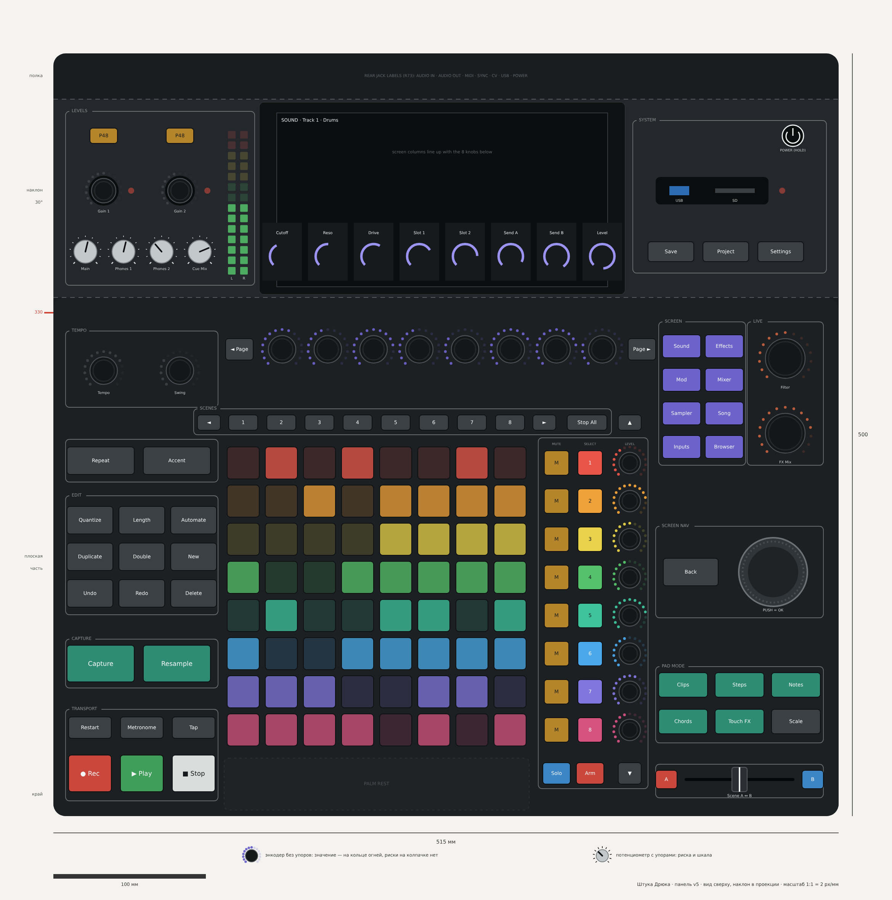

# Штука Дрюка: раскладка панели v5 в миллиметрах

*31.10.2026. Шаг 2 «панели с нуля» (R95): список кнопок — документ 24, здесь — где они стоят. Источник координат — скрипт `layout_v5.py` (в репозитории `mockup/layout/`), он же проверяет нормы; чертёж `panel_v5.png`. Нарисованы 75 кнопок: P59 и P60 (у строки Select и Mute, Solo и Arm — «действие + цель»), без Panic и Help (R99), громкости у гейнов (R100). Обновлено после замечаний пользователя 31.10.2026. **Факт** — из источника, **вывод** — моя логика, **решено** — решение пользователя.*

## 1. Геометрия (решено ранее)

Корпус 515 × 500 мм (R44). Координаты: x — от левого края, y — от переднего края к экрану.

| Часть | y, мм | Что на ней |
|---|---|---|
| Плоская часть | 0–340 | Всё частое |
| Наклон 30° (на чертеже в проекции) | 340–470 | Экран, редкие уровни, система |
| Полка за экраном | 470–500 | Дубль подписей задних гнёзд (R73) |
| Подставка под запястья | перед корпусом, 70 мм | Только под сеткой |

## 2. Блоки: где и почему (вывод)

| Блок | Где (x; y), мм | Что | Почему здесь |
|---|---|---|---|
| Transport | 8–108; 10–70 | ● Rec, ▶ Play, ■ Stop — 28 × 24 мм; ряд Restart, Metronome, Tap | Передний левый угол — ближе всего к левой руке; жмут часто и в долю (R90) |
| Capture | 8–108; 84–116 | Capture, Resample — крупные, 44 × 24 мм | Ядро концепции — сразу за транспортом: это тоже запись |
| Edit | 8–108; 132–210 | 3 × 3 по 30 × 18 мм: спереди Undo, Redo, Delete, в середине Duplicate, Double, New, сзади Quantize, Length, Automate | Частые — ближе к руке |
| Repeat, Accent | 8–108; 225–251 | Две крупные кнопки 44 × 18 мм | Repeat держат левой рукой, пока правая играет пэды (как Note Repeat у Maschine) |
| Tempo | 8–108; 268–318 | Ручки Tempo, Swing | В конце левой колонки, у сгиба: ручки за кнопками (фильтр высоты, R91), задетый темп — неприятно |
| Levels | наклон 8–132; 348–462 | Ближе всего Main, Phones 1, Phones 2, Cue Mix (потенциометры с упорами, шаг 25 мм); выше Gain 1, Gain 2 (утоплены) с индикаторами перегруза; дальше всего P48 (утоплены, удержание 1 с); индикаторы L / R мастера вдоль экрана | Пользователь: «громкости можно унести к гейнам» (R100). Все уровни — один блок в тупиковом углу; Main — угловая ручка, находится вслепую |
| Palm rest | 112–312; 4–38 | Пусто | Место ладоней перед сеткой: здесь нечего задеть |
| Сетка | 112–312; 44–244 | 8 × 8, шаг 25 мм, пэд 21 мм | Центр, обе руки. Дорожка 1 — дальняя строка, как в списке на экране |
| Scenes | 92–366; 250–267 | ◄, сцены 1–8 над своими столбцами, ►, Stop All | **Решено (R101):** над сеткой. ◄ и ► на концах ряда листают сцены и шаги — каждая стрелка стоит у того края, куда листает (P64) |
| Tracks | 318–392; 14–266 | У каждой строки: Mute (x 330), Select (x 352), ручка Level (x 378); ▲ над колонкой, ▼ под ней; спереди Solo и Arm | Mute ближе всего к сетке — его жмут в долю. ▲ и ▼ листают дорожки и стоят на концах колонки дорожек (P64). Solo и Arm без цели ничего не делают |
| Ручки экрана | 113–395; 293–319 | 8 энкодеров, шаг 30 мм; ◄ Page слева от первой, Page ► справа от последней | Под столбцами экрана, один к одному; Page листает страницы этих ручек и стоит на концах их ряда (P64) |
| Crossfader | 395–505; 12–34 | Кроссфейдер с кнопками A и B | У передней кромки. Колпачок фейдера ≈ 12 мм высотой, поэтому рядом с ним только низкие кнопки, а колесо — в 10 см от него (замечание пользователя) |
| Live | 455–505; 230–324 | Filter (y 300) и FX Mix (y 251) | **Решено (R102):** «ручки эффектов поднять на уровень с блоком Screen». Заодно высокие ручки ушли назад, в конец пути руки (R91) |
| Pad mode | 395–505; 48–98 | 2 × 3: сзади Clips, Steps, Notes; спереди Chords, Touch FX, Scale | Низкие кнопки между фейдером и колесом; что делают пэды — рядом с сеткой |
| Screen | 395–451; 230–324 | Сверху Sound, Effects; Mod, Mixer; Sampler, Song; снизу Inputs, Browser | Справа от ряда ручек экрана: «что крутят ручки» — рядом с ручками (как у Push 1) |
| Screen nav | 395–505; 130–190 | Колесо ⌀ 45 мм (нажатие — OK) и Back | Навигация по экрану: колесо листает и выбирает, Back — шаг назад; сенсорный экран — для прямого выбора на экране (P64) |
| System | наклон 380–507; 356–456 | Save, Project, Settings; гнездо USB-A и SD с индикатором записи; Power (утоплена, удержание 2 с) | Редкое — на наклоне, дальше от рук; Power над разъёмом питания сзади |

## 2.1 Как рисуем ручки (решено, R98)

Пользователь: «обязательно рисуй изначально, какие ручки конечны, а какие нет, чтобы не было путаницы. Энкодеры не должны иметь риски на самом нобе».

| Тип | Где | Как выглядит на чертеже и на устройстве |
|---|---|---|
| Энкодер без упоров (бесконечный) | Ручки экрана, Level дорожек, Tempo, Swing, Gain, Filter, FX Mix | Тёмный колпачок **без риски**; значение показывает кольцо из 15 огней вокруг |
| Колесо (бесконечное) | Nav | Без риски и без лунки для пальца — только рифлёный обод |
| Потенциометр с упорами (конечный) | Main, Phones 1, Phones 2, Cue Mix | Светлый металлический колпачок **с риской**, напечатанная шкала с упорами на концах, огней нет |
| Кроссфейдер (конечный) | Live | Ползунок с упорами |

## 2.2 Почему стрелки не убираем совсем (вывод, P64)

Пользователь: «возможно, надо убрать стрелки, особенно если экран сенсорный».

- Стрелки управляют не экраном, а **окном сетки**: какие 8 из 16+ дорожек и какие 8 сцен или шагов видно на пэдах. Без них двигать окно пришлось бы касанием мини-карты на экране.
- Экран — в зоне B (≈ 35–47 см от края), и рука к нему идёт над ручками экрана. Окно сетки двигают часто (R15), а частое по правилу R90 должно быть у рук.
- Поэтому стрелки остаются, но **разнесены по краям сетки**: каждая стоит у того края, куда сдвигает окно. ◄ и ► — на концах ряда сцен (время, это левая рука), ▲ и ▼ — на концах колонки дорожек. Удержание — сдвиг на 8, как раньше.
- Сенсорный экран остаётся для прямого выбора на экране: пункт списка, вкладка, точка на мини-карте (быстрый прыжок далеко). Колесо и Back — для того же без касания.

## 3. Проверки (скрипт `layout_v5.py`)

| Норма | Требование | Получилось |
|---|---|---|
| Шаг ручек | ≥ 25 мм (FAA HFDS, документ 17) | Минимум 25,0 мм — ручки Level дорожек, как и было в R63 |
| Шаг кнопок | ≥ 19 мм | Минимум 22,0 мм |
| Частое в зоне досягаемости | ≤ 330 мм от края | Ни одного частого органа дальше 330 мм |
| Пересечения | Зазор ≥ 2 мм | Нет пересечений |
| Линия сгиба | Ни одного органа на сгибе 340 мм | Нет |
| Количество | По P59, P60, R99 | 75 кнопок (74 + Power), 22 энкодера, 4 потенциометра, колесо, кроссфейдер, 64 пэда |

**Высота органов (вывод):** пэды ≈ 3 мм над панелью; кнопки чуть выступают, ≈ 3–4 мм, с чётким щелчком; низкие энкодеры (экран, дорожки) ≈ 10–12 мм; Filter и FX Mix ≈ 18 мм; потенциометры ≈ 15 мм; колесо плоское ≈ 10 мм.

## 4. Фильтр высоты: пути руки (R91)

| Путь | Над чем проходит рука | Оценка |
|---|---|---|
| Транспорт → захват → правка | Только кнопки | Хорошо |
| Правка → Repeat → Tempo, Swing | Над кнопками | Хорошо; громкости теперь на наклоне и рука к ним над темпом не ходит |
| Пэды → сцены → ручки экрана | Над кнопками сцен | Хорошо |
| Рука к сенсорному экрану | Над ручками экрана | Пока касаются экрана, повороты ручек экрана не принимаются (R94) |
| Пэды → правая колонка | Над ручками Level дорожек | Низкие колпачки + **отсев ладони** (предложение P62): если касание сразу на двух и более соседних ручках, их повороты не принимаются — палец трогает одну ручку, ладонь несколько |
| Спереди к режимам пэдов | Над кроссфейдером | Ход фейдера поперёк движения руки — хорошо |
| К колесу, Filter и FX Mix | Над режимами пэдов (кнопки) | Хорошо: колесо далеко от фейдера, высокие ручки — сзади у экрана |

## 5. Что изменилось относительно наброска v5.2 (R94)

| Было | Стало | Почему |
|---|---|---|
| Ряд сцен под сеткой | Над сеткой | Подальше от ладоней; заголовок столбца сверху, как у Bitwig |
| Filter, FX Mix спереди справа, колесо и Back у экрана | Filter и FX Mix — рядом с блоком Screen; Back, Page, стрелки и колесо — один блок навигации спереди | Решение пользователя (R102) |
| Блок навигации: крест, Back, Page, колесо вместе | Стрелки — на краях сетки (◄ ► у ряда сцен, ▲ ▼ у колонки дорожек); Page — на концах ряда ручек экрана; колесо и Back — отдельный блок «экран» | Пользователь: блок «и логичен, и нет одновременно»; стрелки и экранная навигация делают разные работы (P64) |
| Полоса под сенсорную ленту перед сеткой | Место для ладоней | Лента второй фазы — отдельным модулем (R75), место решим тогда |
| Режимы экрана на наклоне справа | На плоской части справа от ручек экрана | Жмут часто — ближе к руке |
| Громкости на плоской части (первый чертёж v5) | Все уровни вместе на наклоне слева (R100) | Решение пользователя |
| Repeat, Accent справа | Слева, между правкой и темпом | Repeat держит левая рука, пока правая играет |
| Panic, Help | Убраны (R99) | Stop отпускает ноты на выходах; «All Notes Off» — в Settings (P63) |
| Дорожка 1 спереди | Дорожка 1 — дальняя строка | Как список дорожек на экране |
| Mute, Solo, Arm — режимы кнопок дорожек | Mute у каждой строки; Solo, Arm — «действие + цель» | R96, P60 |

## Открытые вопросы

1. Принимаем раскладку v5 (P62)? Тогда переношу её в 3D-модель и в шаблоны 1:1 для картонного макета (R43).
2. ~~Ряд сцен~~ — решено: над сеткой (R101).
3. Отсев ладони на ручках дорожек (P62) — подходит, или ручки дорожек лучше вообще утопить?
