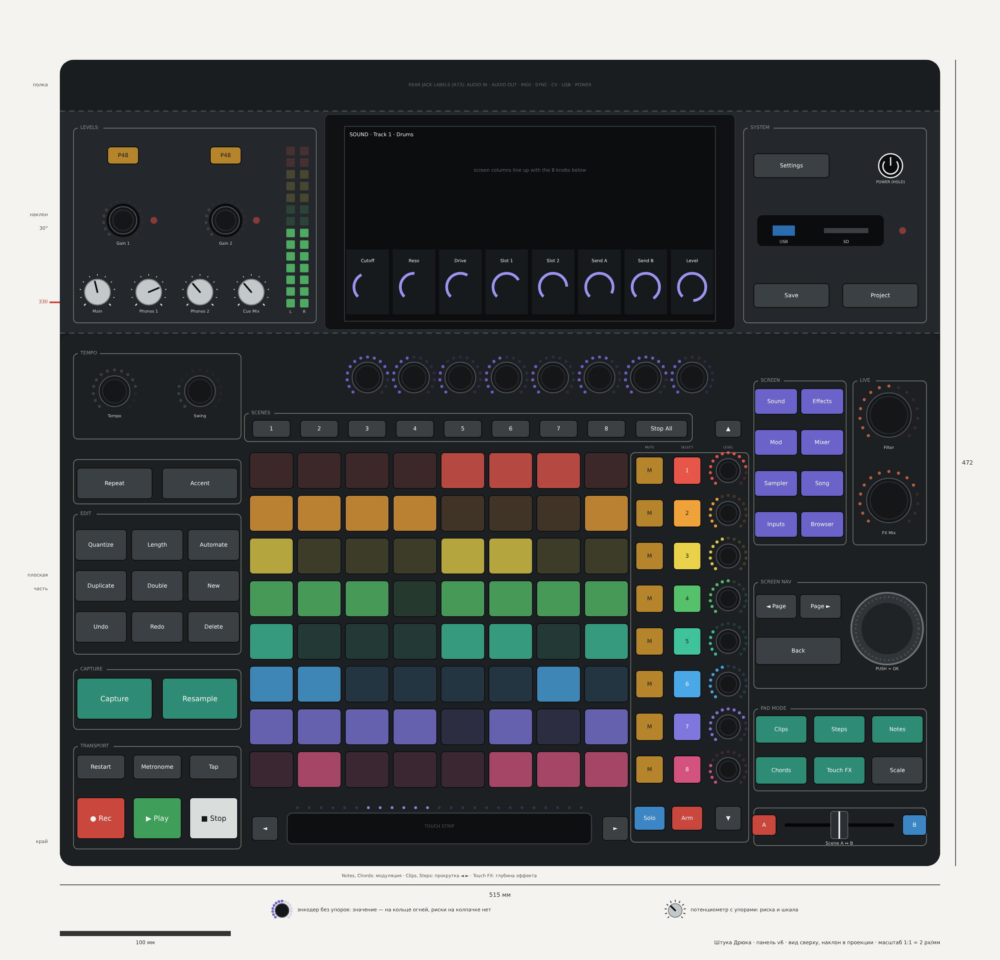

# Штука Дрюка: панель v6 — всё передвинуто заново

*01.11.2026. Продолжение документа 25 (v5). Координаты — скрипт `layout_v6.py` (в репозитории `mockup/layout/`), он же проверяет нормы; чертёж `panel_v6.png`. **Факт** — из источника, **вывод** — моя логика, **решено** — решение пользователя.*

## 0. Что сказал пользователь

- «Энкодеры под экраном имеют конские свободные места, а из-за стрелок будто не может подвинуться. Пошевели всё ещё раз туда-сюда».
- «Было бы здорово заложить пэды как на Force или Push: не квадратные, а как бы для двух пальцев» (**решено, R106**).
- «Блок System выглядит куцым: целый блок выведен, кнопка включения смещена куда-то, куча пустого места, когда всё везде очень плотно».

## 1. Что изменилось и почему (вывод)

| Было (v5) | Стало (v6) | Почему |
|---|---|---|
| Сгиб к наклону на 340 мм, корпус 500 мм в глубину | Сгиб на 312 мм, корпус 472 мм; полка за экраном те же 30 мм, высота 68 / 143 мм та же (P66) | Ручки экрана теперь стоят сразу за рядом сцен, без пустой полосы 30–45 мм. Экран на 28 мм ближе — легче касаться и лучше видно. Корпус на 28 мм короче |
| Экран по центру корпуса (x 135–375) | Сдвинут на 20 мм вправо (x 155–395) (P66) | Слева уровням стало просторнее (142 мм вместо 124), справа блок System плотный, без пустот |
| Ручки экрана шагом 30 мм | Шагом 27,1 мм — ровно под столбцами экрана | Значение на экране точно над своей ручкой; шаг всё равно ≥ 25 мм |
| Пэды 21 × 21 мм, шаг 25 мм | Пэды 25,5 × 21 мм, шаг 28 × 25 мм; сетка 221 × 200 мм (P67) | Шире — помещаются два пальца (R106). Высота строки та же 25 мм, поэтому ручки Level у строк по-прежнему не теснее нормы |
| ◄ ► на концах ряда сцен, ◄ залезал в левую колонку | ◄ ► на концах сенсорной полосы под пэдами (P67) | Горизонталь — вся на одной линии: полоса прокручивает свайпом, стрелки — по шагу. Левая колонка больше ничем не подпёрта. Ход у стрелок потуже — рядом ладони |
| Полоса 202 мм | 178 мм между стрелками — две Trill Bar, обрезанные до ≈ 89 мм | У Trill Bar это предусмотрено: «можно обрезать по размеру» ([Bela](https://learn.bela.io/products/trill/about-trill/)) |
| System: Save, Project, Settings в ряд, Power в углу, гнездо посередине | Сетка 2 × 3: сверху Settings и Power, в середине USB-A и SD с огнём записи, снизу Save и Project (P68) | Ровный блок без дыр; ближе всего к руке — Save, он нужен чаще остального |
| Справа: блоки «вразнобой» | Спереди назад: кроссфейдер → режимы пэдов → навигация по экрану (Back, Page, колесо) → режимы экрана и рядом Filter, FX Mix | Колесо в 10 см от фейдера (R104), высокие ручки — сзади у экрана (R102) |

**Про пэды Force и Push (честно):** точных размеров пэдов Push и Force в обзорах найти не удалось. Sound On Sound пишет только, что пэды Force «меньше, чем у MPC» ([SoS](https://www.soundonsound.com/reviews/akai-force)). Поэтому размер взят из задачи «два пальца рядом» и из того, что помещается в ширину 515 мм.

## 2. Блоки: где что, мм (x — от левого края, y — от переднего)

| Блок | x; y | Состав |
|---|---|---|
| Transport | 8–106; 10–70 | ● Rec, ▶ Play, ■ Stop (28 × 24); Restart, Metronome, Tap |
| Capture | 8–106; 80–115 | Capture, Resample (44 × 24) |
| Edit | 8–106; 124–206 | 3 × 3: Undo, Redo, Delete / Duplicate, Double, New / Quantize, Length, Automate |
| Repeat, Accent | 8–106; 212–238 | Две кнопки 44 × 18 |
| Tempo | 8–106; 250–300 | Tempo, Swing |
| Сенсорная полоса | 113–333; 13–31 | ◄, полоса 178 мм с огнями, ► |
| Сетка | 111–333; 46–242 | 8 × 8 пэдов 25,5 × 21 мм |
| Scenes | 108–370; 249–265 | 1–8, Stop All |
| Tracks | 334–403; 14–261 | У строк Mute, Select, Level; ▲ сверху, ▼ снизу; Solo, Arm спереди |
| Ручки экрана | 168–382; 273–299 | 8 энкодеров, шаг 27,1 мм |
| Crossfader | 406–507; 12–34 | A, фейдер, B |
| Pad mode | 406–507; 44–92 | Clips, Steps, Notes / Chords, Touch FX, Scale |
| Screen nav | 406–507; 104–166 | ◄ Page, Page ►, Back, колесо ⌀ 42 мм |
| Screen | 406–460; 188–284 | Sound, Effects / Mod, Mixer / Sampler, Song / Inputs, Browser |
| Live | 464–507; 188–284 | Filter, FX Mix |
| Levels (наклон) | 8–150; 318–432 | Main, Phones 1, Phones 2, Cue Mix; Gain 1, Gain 2 с огнями перегруза; P48 × 2; индикаторы L / R |
| Экран (наклон) | 155–395; 314–440 | 10,1″ |
| System (наклон) | 400–507; 318–432 | Settings, Power / USB-A и SD / Save, Project |
| Полка | 0–515; 442–472 | Дубль подписей задних гнёзд (R73) |

## 3. Проверки (скрипт)

| Норма | Требование | Получилось |
|---|---|---|
| Шаг ручек | ≥ 25 мм | Минимум 25,0 мм (Level у строк) |
| Шаг кнопок | ≥ 19 мм | Минимум 20,9 мм |
| Частое в зоне досягаемости | ≤ 330 мм от края | Ни одного частого органа дальше 330 мм; самое дальнее частое — ручки экрана, 299 мм |
| Пересечения | Зазор ≥ 2 мм | Нет |
| Сгиб | Ни одного органа на сгибе 312 мм | Нет |
| Количество | — | 75 кнопок (74 + Power), 22 энкодера, 4 потенциометра, колесо, кроссфейдер, полоса, 64 пэда |

## Открытые вопросы

1. Корпус короче на 28 мм (472 вместо 500), экран ближе — принимаем (P66)? Это меняет R44; объём внутри проверю, когда буду обновлять 3D-модель.
2. Пэды 25,5 × 21 мм — хватает «на два пальца»? Если нужно шире (28–30 мм), корпус придётся расширить примерно до 535–550 мм.
3. Принимаем v6 целиком? Тогда 3D-модель и шаблоны 1:1.
