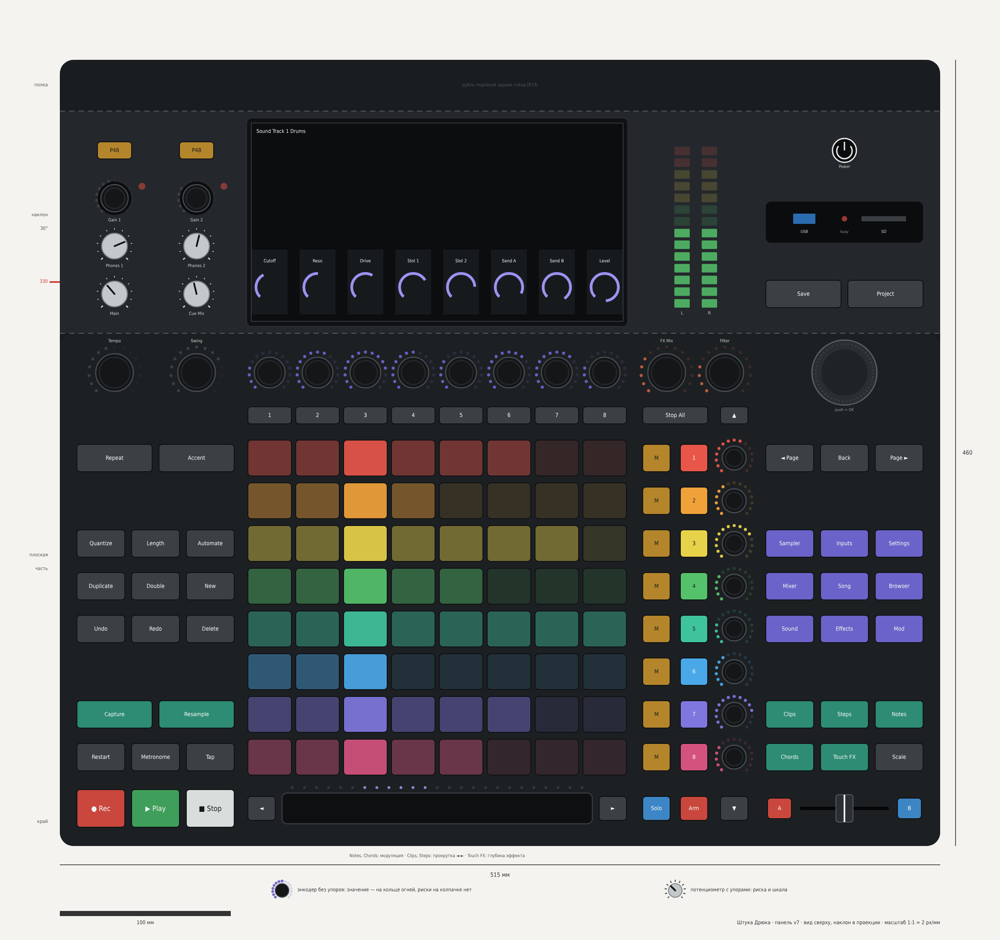

# Штука Дрюка: панель v7 — одна сетка на всю панель

*01.11.2026. Продолжение документа 26 (v6). Координаты — скрипт `layout_v7.py` (в репозитории `mockup/layout/`), он же проверяет нормы; чертёж `panel_v7.png`, он же с наложенной сеткой — `panel_v7_grid.png`. **Факт** — из источника, **вывод** — моя логика, **решено** — решение пользователя. Состав кнопок тот же, что в v6 (документ 24 с поправками R99, P60): поменялись только места и размеры.*



## 0. Что сказал пользователь

«Теперь это всё выглядит асимметрично, разрознено и прям ломает взгляд. Давай подключай дизайнерские навыки».

## 1. Почему v6 ломала взгляд (вывод, честно)

| Что было в v6 | Почему это режет глаз |
|---|---|
| 8 ручек экрана и 8 столбцов пэдов стоят друг над другом, но сдвинуты на 40 мм (экран по своей оси, пэды — по своей) | Число одинаковое, глаз пытается сопоставить «ручка — столбец» и спотыкается |
| 9 разных размеров кнопок (28 × 24, 44 × 24, 30 × 18, 44 × 18, 25 × 15, 32 × 16, 22 × 14 и т. д.) | Нет повторяющегося элемента — каждый блок выглядит «сам по себе» |
| Блоки начинаются и кончаются на разной высоте, ни одна линия не проходит через всю панель | Нет горизонтального ритма |
| Слева и справа колонки устроены по-разному, на наклоне блоки разной ширины | Нет зеркала |
| Рамки вокруг групп и заголовки капслоком | Шум: рамки спорят с кнопками |

Это мои ошибки v5–v6: я двигал блоки по одному под каждое замечание и проверял нормы (шаги, досягаемость), но не проверял общую сетку.

## 2. Дизайн-система v7 (P69)

Пять правил. Каждое проверяется наложением сетки (`panel_v7_grid.png`).

1. **Четыре полосы на всю глубину корпуса.** Каждая полоса продолжается и на наклоне — блок наклона стоит ровно над своей колонкой:

| Полоса | x, мм | На плоской части (рука) | На наклоне |
|---|---|---|---|
| Left | 10–102 | Время: транспорт, захват, правка, Tempo, Swing | Levels |
| Grid | 110–331,5 | Полоса, пэды, сцены, ручки экрана | Экран |
| Tracks | 339–405 | Mute, Select, Level, Stop All, FX Mix, Filter | Индикаторы L / R |
| Right | 413–505 | Кроссфейдер, режимы пэдов, страницы экрана, навигация, колесо | System |

Между полосами — 8 мм. Боковые полосы одинаковые (92 мм) и зеркальны относительно середины корпуса.

2. **Ритм 25 мм по глубине.** Все органы плоской части стоят на линиях: полоса (y 22), строки пэдов 1–8 (52…227), сцены (252), ручки (277). На наклоне — 4 строки через 28 мм, по центру экрана (323, 351, 379, 407).

3. **Одна система столбцов в центре.** Столбец пэдов k = кнопка сцены k = ручка экрана k = столбец на экране k, шаг 28 мм. Окно экрана ровно по ширине сетки. **Факт:** у Push 2 «восемь энкодеров над дисплеем» и «два ряда по восемь кнопок над и под дисплеем» ([руководство Ableton](https://www.ableton.com/en/live-manual/11/using-push-2/)); **вывод** (по фото): у Push 2 и 3 они стоят по столбцам пэдов — тот же приём.

4. **Боковые колонки — зеркало строка в строку:**

| Линия | Left | Right |
|---|---|---|
| Полоса | ● Rec, ▶ Play, ■ Stop | A, кроссфейдер, B |
| 1 | Restart, Metronome, Tap | Chords, Touch FX, Scale |
| 2 | Capture, Resample | Clips, Steps, Notes |
| 3 | — | — |
| 4–6 | Правка 3 × 3 | Страницы экрана 3 × 3 |
| 7 | — | — |
| 8 | Repeat, Accent | ◄ Page, Back, Page ► |
| Сцены | — | — |
| Ручки | Tempo, Swing | Колесо (нажатие — OK) |

Обе колонки кончаются на строке 8 — там же, где верхний край сетки; ряд сцен принадлежит только сетке.

5. **Три размера кнопок в колонках:** крупная 28 × 22 (транспорт), обычная 28 × 16, парная 44 × 16; зазор между кнопками везде 4 мм (3 по 28 или 2 по 44 = 92 мм). У сетки и в колонке дорожек — прежние малые кнопки 16 мм. Рамок и заголовков на панели нет: группы разделяет пустая строка и цвет (бирюзовый — пэды, фиолетовый — экран, коралловый — живые эффекты, цвета дорожек).

**Палитра чертежа:** корпус графит #1d2023, печать тёплый белый #e8ecea, бирюзовый #2d8c73 (ось пэдов), фиолетовый #6b63c9 (ось экрана), коралловый #c0613f (живые эффекты), транспорт красный / зелёный / белый. Шрифт подписей — узкий гротеск (DejaVu Sans Condensed), обычный регистр.

```
 x:  10      102 110                     331 339    405 413      505
     ┌─────────┐ ┌─────────────────────────┐ ┌────────┐ ┌─────────┐   наклон
     │ Levels  │ │         Экран           │ │  L  R  │ │ System  │
     │  2 × 4  │ │  столбцы = столбцам ↓   │ │        │ │         │
     └─────────┘ └─────────────────────────┘ └────────┘ └─────────┘   сгиб 300
277   Tempo Swing  ◯ ◯ ◯ ◯ ◯ ◯ ◯ ◯            FX  Filt     (колесо)
252                1 2 3 4 5 6 7 8            StopAll ▲
227   Repeat Acc.  ▢▢▢▢▢▢▢▢                   M S ◎       ◄P Back P►
202   —            ▢▢▢▢▢▢▢▢                   M S ◎       —
177   Quant…       ▢▢▢▢▢▢▢▢                   M S ◎       Sampler…
152   Dupl…        ▢▢▢▢▢▢▢▢                   M S ◎       Mixer…
127   Undo…        ▢▢▢▢▢▢▢▢                   M S ◎       Sound…
102   —            ▢▢▢▢▢▢▢▢                   M S ◎       —
 77   Capt. Resa.  ▢▢▢▢▢▢▢▢                   M S ◎       Clips Steps Notes
 52   Rest Metr Tap▢▢▢▢▢▢▢▢                   M S ◎       Chords TouchFX Scale
 22   ● ▶ ■        ◄ ════ полоса ════ ►       Solo Arm ▼  A ═fader═ B
```

## 3. Что изменилось против v6 и почему

| Было (v6) | Стало (v7) | Почему |
|---|---|---|
| Экран сдвинут на 20 мм вправо (x 155–395), окно 240 мм | Окно 223 мм ровно над сеткой (x 109–332) | Правило 3. Ширина окна = активная область 10,1″ + 2,75 мм с каждой стороны. Расчёт: диагональ 10,1″ = 256,5 мм; при 16 : 10 ширина 256,5 × 16 / √(16² + 10²) = 217,5 мм, высота 135,9 мм. Сам модуль (с рамкой ≈ 235 мм) — под панелью, его место проверю в 3D |
| Ручки экрана шагом 27,1 мм под столбцами экрана | Шагом 28 мм — над столбцами пэдов; столбцы на экране рисуются там же, по 21,5 мм шириной | 7 × 28 + 21,5 = 217,5 мм — ровно активная область |
| Сгиб на 312 мм, корпус 472 мм | Сгиб на 300 мм, корпус 460 мм; наклон, полка 30 мм и высоты 68 / 143 мм — без изменений | Линия ручек — следующая после сцен (277), сгиб сразу за ней. Меняет R44 (было 500) |
| FX Mix и Filter — в правой колонке у режимов экрана | На линии ручек над колонкой дорожек (x 355 и 389) | Линия ручек сплошная: время — экран — живые эффекты — колесо. По-прежнему сзади, у экрана (R91, R102) |
| Колесо ⌀ 42 мм в середине правой колонки, Back и Page сбоку | Колесо ⌀ 38 мм в конце линии ручек (x 459), прямо под ним ◄ Page, Back, Page ► | Зеркало левой колонки (Tempo, Swing над Repeat, Accent). До кроссфейдера теперь 255 мм — колесо и высокий фейдер не встречаются (R104). Page по-прежнему рядом с Back. ⌀ 38 — чтобы до сгиба оставалось 4 мм |
| Режимы экрана 2 × 4 мелких кнопки (20–21 мм) | Страницы экрана 3 × 3 обычных кнопок, по строкам по смыслу: Sound, Effects, Mod (звук дорожки) / Mixer, Song, Browser (весь проект) / Sampler, Inputs, Settings (источники и устройство) | Зеркало блока правки; кнопки крупнее. Settings переехала с наклона — все страницы экрана в одном блоке; стоит в дальнем углу блока, потому что нужна редко (R90) |
| Индикаторы L / R слева у уровней | На наклоне над колонкой дорожек (x 364 и 380) | Как на микшерном пульте: общий уровень — в конце линейки каналов. Левый блок наклона — только уровни |
| Уровни: 4 ручки в ряд (шире колонки), гейны, P48 | Блок 2 × 4 ровно в левой колонке: Main, Cue Mix / Phones 1, Phones 2 / Gain 1, Gain 2 с огнями перегруза / P48, P48 | Не вылезает за колонку; Main ближе всех — на случай «срочно убавить» |
| System 2 × 3 (Settings, Power / USB и SD / Save, Project) | Save, Project / карман USB-A и SD во всю ширину колонки, огонь занятости внутри / Power по центру | Над правой колонкой, без дыр; Settings — в страницах экрана |
| Tempo, Swing на x 33 и 79 | На x 32 и 80 — на осях парных кнопок | Одна ось с Capture, Resample, Repeat, Accent |
| Рамки групп и заголовки | Убраны | Правило 5 |
| Пэды, колонка дорожек, полоса со стрелками | Без изменений (R105, R106, P67) | — |

## 4. Блоки: где что, мм (x — от левого края, y — от переднего)

| Блок | x; y | Состав |
|---|---|---|
| Транспорт | 10–102; 11–60 | ● Rec, ▶ Play, ■ Stop (28 × 22); Restart, Metronome, Tap |
| Захват | 10–102; 69–85 | Capture, Resample (44 × 16) |
| Правка | 10–102; 119–185 | 3 × 3: Undo, Redo, Delete / Duplicate, Double, New / Quantize, Length, Automate |
| Repeat, Accent | 10–102; 219–235 | 44 × 16 |
| Tempo, Swing | 17–95; 262–292 | Энкодеры ⌀ 22, кольцо 30 |
| Полоса | 110–331,5; 13–31 | ◄, полоса 181,5 мм с огнями, ► |
| Сетка | 110–331,5; 41,5–237,5 | 8 × 8 пэдов 25,5 × 21, шаг 28 × 25 |
| Сцены | 110–331,5; 247–257 | 1–8 над столбцами |
| Ручки экрана | 110,75–330,75; 265–289 | 8 энкодеров ⌀ 18 над столбцами |
| Дорожки | 339–405; 15–257 | Solo, Arm, ▼; у строк Mute, Select, Level; Stop All, ▲ |
| FX Mix, Filter | 340–404; 262–292 | Энкодеры ⌀ 22, кольцо 30 |
| Кроссфейдер | 413–505; 16–28 | A, фейдер 52 мм, B |
| Режимы пэдов | 413–505; 44–85 | Chords, Touch FX, Scale / Clips, Steps, Notes |
| Страницы экрана | 413–505; 119–185 | 3 × 3, см. раздел 3 |
| Навигация | 413–505; 219–296 | ◄ Page, Back, Page ►; колесо ⌀ 38 на y 277 |
| Levels (наклон) | 10–102; 312–412 | 2 × 4 |
| Экран (наклон) | 109–332; 304–426 | Окно 223 × 141 мм по наклону |
| Индикаторы (наклон) | 359–385; 313–417 | L, R |
| System (наклон) | 413–505; 315–414 | Save, Project / USB-A и SD / Power |
| Полка | 0–515; 430–460 | Дубль подписей задних гнёзд (R73) |

## 5. Проверки (скрипт)

| Норма | Требование | Получилось |
|---|---|---|
| Шаг ручек | ≥ 25 мм | Минимум 25,0 мм (Level у строк) |
| Шаг кнопок | ≥ 19 мм | Минимум 22,0 мм |
| Частое в зоне досягаемости | ≤ 330 мм от края | Ни одного частого органа дальше 330 мм; самые дальние частые — линия ручек и колесо, 277 мм |
| Пересечения | Зазор ≥ 2 мм | Нет |
| Сгиб | Ни одного органа ближе 2 мм к сгибу 300 мм | Нет; ближе всех колесо — 4 мм |
| Количество | Как в v6 | 75 кнопок (74 + Power), 22 энкодера, 4 потенциометра, колесо, кроссфейдер, полоса, 64 пэда |

**Фильтр высоты (R91), вывод:** высокие органы — Tempo, Swing, FX Mix, Filter, колесо и все потенциометры — стоят на линии ручек или на наклоне, то есть в самом конце пути руки; спереди и в середине — только кнопки, пэды и низкие энкодеры Level. Кроссфейдер — в правом переднем углу, как в v6.

## Открытые вопросы

1. Принимаем принцип «четыре полосы»: экран над сеткой, а не по центру корпуса? Минус — середина корпуса не зеркальная, экран на 37 мм левее центра. Плюс — ручки, столбцы экрана, сцены и пэды стоят на одних осях.
2. Settings — в блоке страниц экрана, индикаторы L / R — над колонкой дорожек: так нормально?
3. Корпус 460 мм в глубину (R44 — 500, v6 — 472): объём внутри и место модуля экрана проверю в 3D. Принимаем v7 целиком — тогда 3D-модель и шаблоны 1:1.

Sources: [Ableton — Using Push 2](https://www.ableton.com/en/live-manual/11/using-push-2/)
