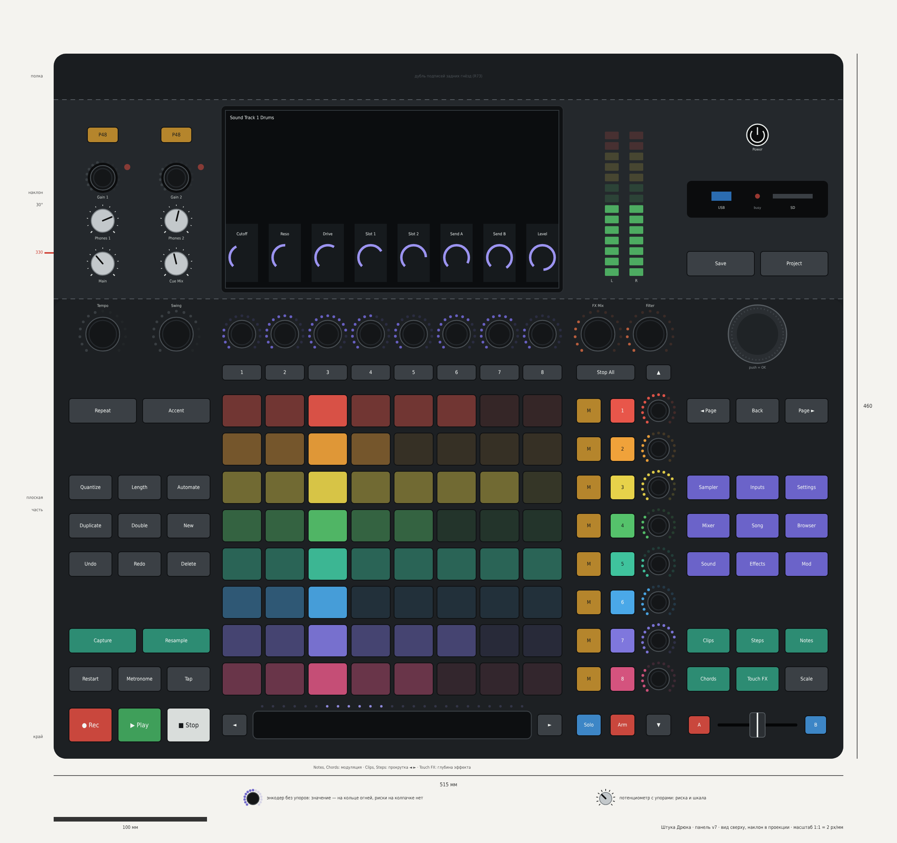

> Часть документа 27 ([индекс](../27_panel_v7_layout.md)): Штука Дрюка: панель v7 — одна сетка на всю панель

# Штука Дрюка: панель v7 — одна сетка на всю панель

*01.11.2026. Продолжение документа 26 (v6). Координаты — скрипт `layout_v7.py` (в репозитории `mockup/layout/`), он же проверяет нормы; чертёж `panel_v7.png`, он же с наложенной сеткой — `panel_v7_grid.png`. **Факт** — из источника, **вывод** — моя логика, **решено** — решение пользователя. Состав кнопок тот же, что в v6 (документ 24 с поправками R99, P60): поменялись только места и размеры.*

> **Решено 01.11.2026 (R107):** «Да, принимаем… пока» — v7 рабочая раскладка, пересмотреть можно. По ней обновлены 3D-модель (`model3d/index.html`, строится из того же `layout_v7.json`) и шаблоны картонного макета 1:1 (`mockup/shtuka_druka_mockup_1to1_v7.pdf`, 16 листов A4); раздел 6 — что помещается внутри.

